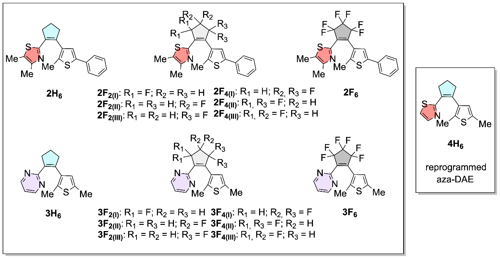

# data_azaDAE_bridge_substitution

xyz coordinate files for 
- open, closed and ZI-Z isomers of **2H6** and **3F6**
- open, closed and ZI-Z isomers of three positional isomers of **2H2**, **2H4**, **3F2** and **3F4** (**I-III** each)
- open, closed, ZI-Z and ZI-E isomers of **4H6** and the S0/S1 conical intersection (CI) between open and closed isomers.

All structures were optimized using CAM-B3LYP/def2-TZVP with CPCM(Methanol), with one exception: The CI was optimized using mixed-reference spin-flip TDDFT with BHHLYP/6-31G*.

